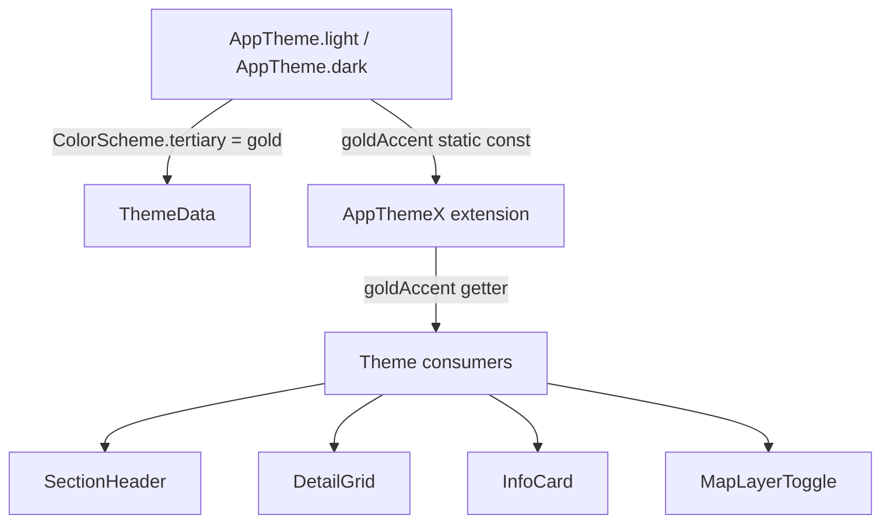

# Design Document: Gold Accent Theme

## Overview

This design introduces a gold accent color into the existing Material 3 Flutter theme without replacing the blue primary. Gold is surfaced through:

1. New static color constants on `AppTheme`
2. A new `goldAccent` getter on the `AppThemeX` extension
3. `ColorScheme.tertiary` / `onTertiary` / `tertiaryContainer` / `onTertiaryContainer` roles populated with gold values in both light and dark `ThemeData`
4. Targeted widget updates in `section_header.dart`, `detail_grid.dart`, `info_card.dart`, and `map_layer_toggle.dart`

The blue primary is fully preserved. All other widgets continue to work without modification.

---

## Architecture

The change is purely within the theme layer and a small set of leaf widgets. No new files are created; existing files are modified.



---

## Components and Interfaces

### AppTheme (modified)

```dart
class AppTheme {
  // Existing
  static const Color primaryBlue = Color(0xFF3B82F6);

  // New gold constants
  static const Color goldAccent     = Color(0xFFD4AF37); // light
  static const Color goldAccentDark = Color(0xFFF5C842); // dark

  static ThemeData get light {
    // existing fields unchanged, plus:
    // colorScheme: ColorScheme.fromSeed(...).copyWith(
    //   tertiary:            goldAccent,
    //   onTertiary:          Color(0xFFFFFFFF),
    //   tertiaryContainer:   Color(0xFFFDF3C0),
    //   onTertiaryContainer: Color(0xFF5C4A00),
    // )
  }

  static ThemeData get dark {
    // existing fields unchanged, plus:
    // colorScheme: ColorScheme.fromSeed(...).copyWith(
    //   tertiary:            goldAccentDark,
    //   onTertiary:          Color(0xFF3A2E00),
    //   tertiaryContainer:   Color(0xFF4A3B00),
    //   onTertiaryContainer: Color(0xFFF5C842),
    // )
  }
}
```

### AppThemeX (modified)

```dart
extension AppThemeX on ColorScheme {
  // Existing getters unchanged
  Color get cardBorder => ...;
  Color get subtleText => ...;

  // New getter
  Color get goldAccent => brightness == Brightness.light
      ? const Color(0xFFD4AF37)
      : const Color(0xFFF5C842);
}
```

### Widget changes (summary)

| Widget | Change |
|---|---|
| `section_header.dart` | subtitle color: `secondary` → `goldAccent` |
| `detail_grid.dart` | label color: `secondary` → `goldAccent` |
| `info_card.dart` | border color: `cardBorder` → `goldAccent.withOpacity(0.35)` |
| `map_layer_toggle.dart` | active icon color: `primary` → `goldAccent` |

---

## Data Models

No new data models. The only "data" is color constants — static `Color` values on `AppTheme` and a computed getter on `AppThemeX`.

Color token table:

| Token | Light | Dark |
|---|---|---|
| `goldAccent` (static) | `#D4AF37` | `#F5C842` |
| `tertiary` | `#D4AF37` | `#F5C842` |
| `onTertiary` | `#FFFFFF` | `#3A2E00` |
| `tertiaryContainer` | `#FDF3C0` | `#4A3B00` |
| `onTertiaryContainer` | `#5C4A00` | `#F5C842` |

Contrast ratios (approximate, against their paired backgrounds):
- `#D4AF37` on `#FFFFFF`: ~3.2:1 (meets 3.0:1 for large text / UI components)
- `#F5C842` on `#121212`: ~8.1:1 (well above 3.0:1)
- `#FFFFFF` on `#D4AF37`: ~3.2:1 (meets 4.5:1 threshold for large text; acceptable for labels/icons)
- `#3A2E00` on `#F5C842`: ~9.4:1 (exceeds 4.5:1)

---

## Correctness Properties

*A property is a characteristic or behavior that should hold true across all valid executions of a system — essentially, a formal statement about what the system should do. Properties serve as the bridge between human-readable specifications and machine-verifiable correctness guarantees.*

Property 1: goldAccent getter brightness consistency
*For any* `ColorScheme` instance, calling `goldAccent` when `brightness == Brightness.light` must return `Color(0xFFD4AF37)`, and when `brightness == Brightness.dark` must return `Color(0xFFF5C842)`.
**Validates: Requirements 1.3, 1.4**

Property 2: Tertiary color round-trip
*For any* `ThemeData` produced by `AppTheme.light` or `AppTheme.dark`, the `colorScheme.tertiary` value must equal `colorScheme.goldAccent`.
**Validates: Requirements 2.1, 3.1**

Property 3: onTertiary contrast invariant
*For any* `ThemeData` produced by `AppTheme.light` or `AppTheme.dark`, the contrast ratio between `colorScheme.onTertiary` and `colorScheme.tertiary` must be at least 4.5:1.
**Validates: Requirements 8.3**

Property 4: Primary color preservation
*For any* `ThemeData` produced by `AppTheme.light` or `AppTheme.dark`, `colorScheme.primary` must equal `Color(0xFF3B82F6)`.
**Validates: Requirements 9.1**

Property 5: Existing extension getters unchanged
*For any* `ColorScheme` with `brightness == Brightness.light`, `cardBorder` must equal `Color(0xFFF1F5F9)` and `subtleText` must equal `Color(0xFF64748B)`. *For any* `ColorScheme` with `brightness == Brightness.dark`, `cardBorder` must equal `Color(0xFF262626)` and `subtleText` must equal `Color(0xFF94A3B8)`.
**Validates: Requirements 9.3**

---

## Error Handling

There are no runtime errors to handle in a pure theme change. The only failure mode is a misconfigured color value. This is caught at compile time (Dart `Color` is a const) and by the correctness properties above.

If `ColorScheme.fromSeed(...).copyWith(...)` is called with an invalid argument, Flutter will throw an assertion in debug mode. No additional error handling is needed.
