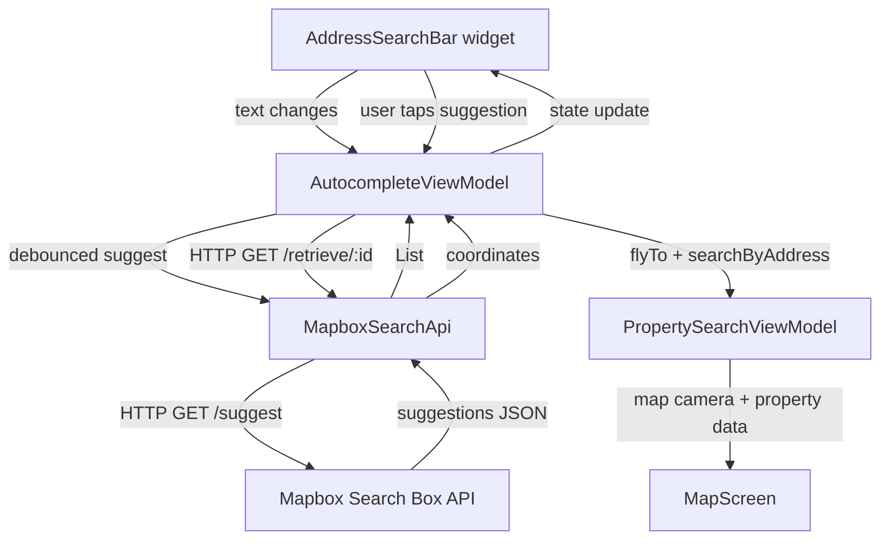

# Design Document: Search Autocomplete

## Overview

This feature extends the existing `AddressSearchBar` widget with Mapbox-powered address autocomplete. As the user types, a debounced query is sent to the Mapbox Search Box API (`/suggest`), and a dropdown overlay renders up to 5 suggestions. Tapping a suggestion calls the `/retrieve` endpoint to get full coordinates, flies the map camera to that location, and triggers the existing `PropertySearchViewModel.searchByAddress` flow.

The implementation follows the app's existing clean architecture: a new datasource (`MapboxSearchApi`) handles HTTP, a new domain entity (`AddressSuggestion`) models the data, and a new Riverpod `AutocompleteViewModel` manages state. The existing `AddressSearchBar` widget is extended to render the suggestion overlay.

---

## Architecture



The `AutocompleteViewModel` is the single source of truth for autocomplete state. It owns the debounce timer and session token lifecycle. The widget layer is purely reactive — it renders whatever state the ViewModel exposes.

---

## Components and Interfaces

### `AddressSuggestion` (domain entity)

```dart
// lib/domain/entities/address_suggestion.dart
@freezed
abstract class AddressSuggestion with _$AddressSuggestion {
  const factory AddressSuggestion({
    required String mapboxId,
    required String fullName,
    String? context,       // locality / place type secondary line
    double? latitude,
    double? longitude,
  }) = _AddressSuggestion;

  factory AddressSuggestion.fromJson(Map<String, Object?> json) =>
      _$AddressSuggestionFromJson(json);
}
```

### `MapboxSearchApi` (data source)

```dart
// lib/data/datasources/mapbox_search_api.dart
class MapboxSearchApi {
  Future<List<AddressSuggestion>> suggest(String query, String sessionToken);
  Future<AddressSuggestion> retrieve(String mapboxId, String sessionToken);
}
```

Uses a dedicated `Dio` instance pointed at `https://api.mapbox.com/search/searchbox/v1` with `AppConstants.mapboxApiKey` appended as a query parameter. Does **not** reuse `dioProvider` (different base URL and auth scheme).

### `AutocompleteState` (sealed state)

```dart
// lib/presentation/viewmodels/autocomplete_viewmodel.dart
sealed class AutocompleteState {
  const AutocompleteState();
}
class AutocompleteIdle    extends AutocompleteState { const AutocompleteIdle(); }
class AutocompleteLoading extends AutocompleteState { const AutocompleteLoading(); }
class AutocompleteResults extends AutocompleteState {
  final List<AddressSuggestion> suggestions;
  const AutocompleteResults(this.suggestions);
}
class AutocompleteEmpty   extends AutocompleteState { const AutocompleteEmpty(); }
class AutocompleteError   extends AutocompleteState {
  final AutocompleteErrorKind kind;
  const AutocompleteError(this.kind);
}

enum AutocompleteErrorKind { network, auth, retrieveFailed }
```

### `AutocompleteViewModel` (Riverpod Notifier)

```dart
// lib/presentation/viewmodels/autocomplete_viewmodel.dart
final autocompleteViewModelProvider =
    NotifierProvider<AutocompleteViewModel, AutocompleteState>(
        AutocompleteViewModel.new);

class AutocompleteViewModel extends Notifier<AutocompleteState> {
  void onQueryChanged(String query);   // called on every keystroke
  Future<void> selectSuggestion(AddressSuggestion suggestion, WidgetRef ref);
  void dismiss();                      // clears suggestions, keeps text
  void clearError();                   // called when user resumes typing after error
}
```

### `AddressSearchBar` (extended widget)

The existing widget gains:
- A `FocusNode` to detect outside taps via `TapRegion`
- A `CompositedTransformTarget` + `CompositedTransformFollower` pair for the overlay
- An `OverlayEntry` that renders the `_SuggestionList` child widget
- A listener on `autocompleteViewModelProvider` to show/hide the overlay

---

## Data Models

### Mapbox `/suggest` response mapping

```
features[].properties.mapbox_id  → AddressSuggestion.mapboxId
features[].properties.full_address (or name) → AddressSuggestion.fullName
features[].properties.context.place.name     → AddressSuggestion.context
```

Coordinates are **not** present in the suggest response; they are fetched via `/retrieve`.

### Mapbox `/retrieve/:mapbox_id` response mapping

```
features[0].geometry.coordinates[0] → AddressSuggestion.longitude
features[0].geometry.coordinates[1] → AddressSuggestion.latitude
features[0].properties.full_address → AddressSuggestion.fullName (confirmed)
```

### `AppConstants` additions

```dart
static const int autocompleteDebounceMs = 350;
static const int autocompleteMinChars   = 2;
static const int autocompleteMaxResults = 5;
```

---

## Correctness Properties

*A property is a characteristic or behavior that should hold true across all valid executions of a system — essentially, a formal statement about what the system should do. Properties serve as the bridge between human-readable specifications and machine-verifiable correctness guarantees.*

### Property 1: Debounce fires only once per rapid-input burst

*For any* sequence of query strings where each keystroke arrives faster than `autocompleteDebounceMs`, the `AutocompleteViewModel` SHALL issue exactly one API call — corresponding to the final query in the sequence — and zero calls for all intermediate queries.

**Validates: Requirements 1.1, 1.2**

---

### Property 2: Short input always produces idle state

*For any* input string whose length is less than `autocompleteMinChars`, the resulting `AutocompleteState` SHALL be `AutocompleteIdle` with an empty suggestion list and no pending query.

**Validates: Requirements 1.3**

---

### Property 3: Session token present on every API request

*For any* query dispatched to the Mapbox Search Box API (both `/suggest` and `/retrieve`), the outgoing HTTP request SHALL include a non-empty `session_token` query parameter.

**Validates: Requirements 1.4**

---

### Property 4: Suggestion list is capped at max results

*For any* API response containing N suggestions where N > `autocompleteMaxResults`, the `AutocompleteResults.suggestions` list SHALL contain exactly `autocompleteMaxResults` items.

**Validates: Requirements 2.2**

---

### Property 5: Suggestion serialization round-trip

*For any* valid `AddressSuggestion` object, serializing it to JSON and deserializing it back SHALL produce an object equal to the original, preserving all fields including `mapboxId`, `fullName`, `context`, `latitude`, and `longitude`.

**Validates: Requirements 2.3**

---

### Property 6: Stale response is discarded when superseded

*For any* pair of overlapping requests where the second query is dispatched before the first response arrives, the final `AutocompleteState` SHALL reflect only the result of the second (latest) query.

**Validates: Requirements 3.2**

---

### Property 7: Suggestion selection populates text and triggers property search

*For any* `AddressSuggestion` with valid coordinates, tapping it SHALL (a) set the search bar text to `suggestion.fullName`, (b) dismiss the suggestion overlay, and (c) call `PropertySearchViewModel.searchByAddress` with `suggestion.fullName`.

**Validates: Requirements 4.3, 4.4**

---

### Property 8: Retrieve failure does not navigate camera

*For any* suggestion whose `/retrieve` call returns an error, the `AutocompleteViewModel` SHALL transition to `AutocompleteError(retrieveFailed)` and SHALL NOT emit a `flyTo` command or call `searchByAddress`.

**Validates: Requirements 5.3**

---

### Property 9: Error state clears on resumed typing

*For any* `AutocompleteError` state, calling `onQueryChanged` with a query of length ≥ `autocompleteMinChars` SHALL transition the state away from `AutocompleteError` before the debounce fires.

**Validates: Requirements 5.4**

---

### Property 10: Semantics label contains full place name

*For any* `AddressSuggestion` rendered as a list item, the widget's `Semantics` label SHALL contain the suggestion's `fullName` string.

**Validates: Requirements 7.1**

---

## Error Handling

| Scenario | HTTP status | State transition | UI message |
|---|---|---|---|
| Network timeout / unreachable | — | `AutocompleteError(network)` | "Could not load suggestions. Please try again." |
| API error (non-auth) | 4xx / 5xx (not 401/403) | `AutocompleteError(network)` | "Could not load suggestions. Please try again." |
| Auth failure | 401 / 403 | `AutocompleteError(auth)` | "Search unavailable." |
| Retrieve failure | any | `AutocompleteError(retrieveFailed)` | Snackbar: "Could not load location details." |
| Zero results | 200, empty list | `AutocompleteEmpty` | "No results found" inline in dropdown |

All errors are cleared when the user modifies the search input (via `onQueryChanged`).

The `MapboxSearchApi` wraps `DioException` and maps status codes to typed exceptions before they reach the ViewModel, keeping error-handling logic out of the widget layer.
